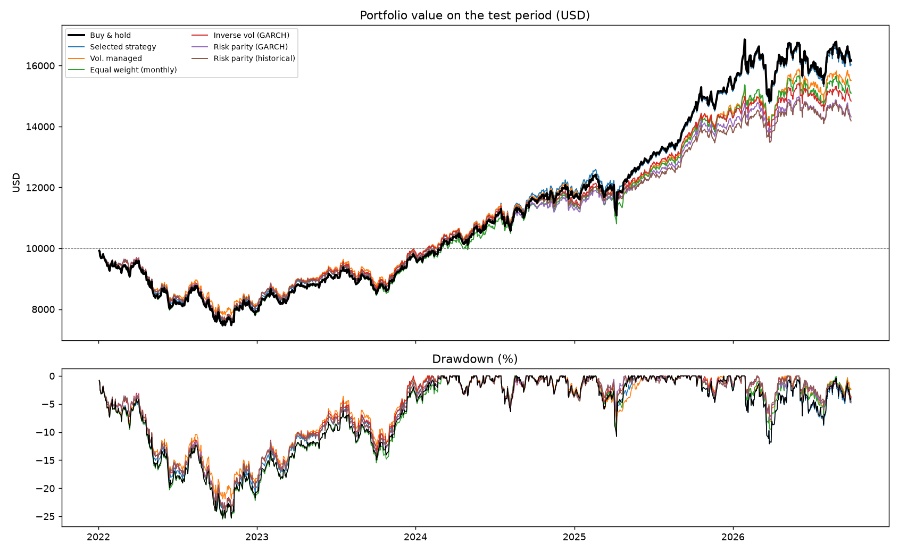
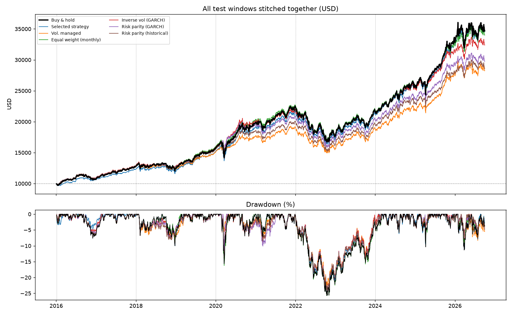
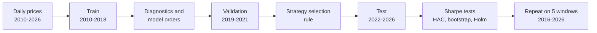

# Can econometric forecasts beat buy & hold?

**A walk-forward backtest with formal statistical tests on four ETFs (SPY, QQQ, GLD, TLT), 2010–2026.**

[](https://github.com/joangordo/can-forecasts-beat-buy-and-hold/actions/workflows/tests.yml)


> **Not investment advice.** This is an educational research project. Historical results say nothing about future returns.

Most stock-prediction projects show a backtest that looks good and stop there. This one is set up the other way round: **buy & hold is the null hypothesis**. A forecasting strategy only counts if it beats it out of sample, after costs, by a margin chosen in advance, and with a difference that survives a significance test corrected for multiple comparisons.

## Results

<!-- RESULTS:START -->
_Generated by `python -m beatbh` on 2026-11-11. Out-of-sample test period: 2022-01-03 to 2026-09-30. USD 10,000 initial capital, costs included, cash earns T-bills, Sharpe ratios in excess of T-bills._

**Key results**

- Return forecasts significantly more accurate than a random walk on the test period (Diebold-Mariano, 5 %): none, out of 16 model-asset pairs.
- Direction classifiers (logistic regression, gradient boosting) called the sign of the next day's return correctly 49.3-54.3 % of the time; always answering 'up' scored 52.8 %.
- Strategy selected on validation (SPY: Vol (1.50), QQQ: Vol (1.25), GLD: B&H, TLT: B&H) vs buy & hold on the test period: Sharpe 0.53 vs 0.52 (Holm-adjusted p = 1.00).
- Strategies whose Sharpe ratio differs significantly from buy & hold on the test period (HAC test, Holm-adjusted, 5 %): none.
- Repeating everything on 5 consecutive test windows (2016-2026), the selected strategy beat buy & hold's Sharpe in 2 of 5; on the stitched 2,701-day out-of-sample record the difference is +0.02 (Holm-adjusted p = 1.00).
- Significant differences on the stitched record (Holm, 5 %): none.

**Test period, 2022-01-03 to 2026-09-30**

| Strategy | CAGR % | Volatility % | Sharpe | Max drawdown % | ΔSharpe vs B&H | p (HAC, Holm) | p (bootstrap) |
|---|---|---|---|---|---|---|---|
| Buy & hold | 10.70 | 13.79 | 0.52 | -25.34 | – | – | – |
| Selected strategy | 10.50 | 13.08 | 0.53 | -24.19 | 0.01 | 1.00 | 0.84 |
| Vol. managed | 9.74 | 11.28 | 0.53 | -21.91 | 0.01 | 1.00 | 0.92 |
| Equal weight (monthly) | 9.11 | 13.04 | 0.43 | -25.49 | -0.09 | 1.00 | 0.18 |
| Inverse vol (GARCH) | 8.71 | 11.67 | 0.44 | -23.97 | -0.08 | 1.00 | 0.42 |
| Risk parity (GARCH) | 7.89 | 11.39 | 0.38 | -24.09 | -0.14 | 1.00 | 0.23 |
| Risk parity (historical) | 7.68 | 11.43 | 0.36 | -24.17 | -0.16 | 1.00 | 0.19 |



**Robustness: the whole procedure repeated on consecutive test windows**

Sharpe ratio per test window (each window has its own train and validation periods):

| Strategy | 2016-2017 | 2018-2019 | 2020-2021 | 2022-2023 | 2024-2026 | mean | beats_bh |
|---|---|---|---|---|---|---|---|
| Buy & hold | 1.84 | 0.99 | 1.39 | -0.29 | 1.02 | 0.99 | - |
| Selected strategy | 1.76 | 0.99 | 1.39 | -0.25 | 1.11 | 1.00 | 2 of 5 |
| Vol. managed | 1.88 | 0.90 | 1.47 | -0.27 | 1.01 | 1.00 | 3 of 5 |
| Equal weight (monthly) | 1.89 | 1.08 | 1.35 | -0.29 | 1.01 | 1.01 | 3 of 5 |
| Inverse vol (GARCH) | 1.98 | 1.14 | 1.42 | -0.24 | 1.01 | 1.06 | 4 of 5 |
| Risk parity (GARCH) | 1.94 | 1.18 | 1.30 | -0.29 | 0.96 | 1.02 | 2 of 5 |
| Risk parity (historical) | 1.99 | 1.04 | 1.17 | -0.29 | 0.93 | 0.97 | 2 of 5 |

All windows stitched together:

| Strategy | CAGR % | Volatility % | Sharpe | Max drawdown % | ΔSharpe vs B&H | p (HAC, Holm) | p (bootstrap) |
|---|---|---|---|---|---|---|---|
| Buy & hold | 12.30 | 11.63 | 0.86 | -25.70 | – | – | – |
| Selected strategy | 12.27 | 11.23 | 0.89 | -24.56 | 0.02 | 1.00 | 0.64 |
| Vol. managed | 10.17 | 9.29 | 0.85 | -22.52 | -0.02 | 1.00 | 0.88 |
| Equal weight (monthly) | 12.09 | 11.44 | 0.86 | -25.75 | -0.00 | 1.00 | 0.89 |
| Inverse vol (GARCH) | 11.58 | 10.14 | 0.91 | -24.18 | 0.05 | 1.00 | 0.54 |
| Risk parity (GARCH) | 10.70 | 9.84 | 0.85 | -24.32 | -0.01 | 1.00 | 0.93 |
| Risk parity (historical) | 10.28 | 9.95 | 0.81 | -24.34 | -0.06 | 1.00 | 0.50 |


<!-- RESULTS:END -->

## Method



1. **Diagnostics, on training data only.** Descriptive statistics, ADF and KPSS stationarity tests, Ljung-Box and ARCH-LM tests, Granger causality in a VAR, Johansen and Engle-Granger cointegration tests.
2. **One-day-ahead forecasts, walk-forward.** Random walk and historical mean as benchmarks; ARIMA; AR-GARCH(1,1) with Student-t errors; VAR; and two direction classifiers (logistic regression and gradient boosting on lagged returns, momentum, volatility, RSI, MACD, Bollinger %b and moving-average distances). Model orders are chosen on the training data by AIC/BIC and then **frozen**: only the parameters are re-estimated each month, on an expanding window.
3. **Strategies.**
   - *Signal rules*: invested when the forecast (a return, or the probability of an up day) exceeds a threshold; otherwise in T-bills.
   - *Volatility management*: always invested, but exposure is cut when the GARCH forecast exceeds a multiple of the asset's historical volatility (Moreira & Muir, 2017).
   - *Asset allocation*: equal weight, inverse volatility and equal-risk-contribution (risk parity) weights, using either GARCH or realised volatility, rebalanced monthly.
4. **Selection on validation.** Thresholds and factors are tuned on the validation period only. For each asset, a strategy replaces buy & hold only if its validation Sharpe ratio beats buy & hold's by at least 0.20 and, for signal rules, it completed at least 10 trades.
5. **Out-of-sample test.** 0.10 % commission and 0.05 % slippage on every traded dollar; uninvested cash earns the 13-week T-bill rate; Sharpe ratios use excess returns. Each day's position is decided with data up to the previous close.
6. **Statistical tests.** Sharpe ratio difference against buy & hold with a HAC test (Ledoit & Wolf, 2008) and a circular block bootstrap (Politis & Romano, 1992), Holm-adjusted (Holm, 1979). Forecast accuracy against a random walk with the Diebold-Mariano test (Diebold & Mariano, 1995) and the Harvey-Leybourne-Newbold correction.
7. **Robustness.** The whole procedure (model orders, validation, selection, test) is repeated on five consecutive test windows from 2016 to 2026, in parallel, and the windows are stitched into one out-of-sample record.

## Guarding against look-ahead bias

The test suite runs on every push (GitHub Actions). Its core idea is simple: if anything computed for day *t* used information from day *t* or later, then replacing the data after a cut-off date with noise would change it. The tests scramble the "future" and check that **no forecast (ARIMA, GARCH, VAR, classifiers), feature, position or portfolio weight before the cut-off changes**, and that later values do change, so the tests are not vacuous. Other tests check the backtest accounting (purchase costs, turnover costs, interest on cash), that risk parity equalises risk contributions, and that the Sharpe test rejects about 5 % of the time when there is no real difference.

## Limitations

- **The main test period is not a pristine hold-out.** An earlier version re-selected the model orders right before the test period and lost heavily there; the methodology was corrected after seeing that. The 2022–2026 results are therefore not fully untouched. The robustness windows covering 2016–2019 were never used to make any design decision.
- **The asset universe was chosen with hindsight**: QQQ's strong decade and TLT's 2022 crash are known today.
- Close-to-close execution, flat costs, no taxes, no leverage and no short selling. Adjusted prices from Yahoo Finance. Results in US dollars.

## Project structure

```
beatbh/
  data.py           download (cached), log returns, chronological split, T-bill rate
  econometrics.py   diagnostics on the training sample
  models.py         order selection, walk-forward forecasts, Diebold-Mariano
  strategies.py     positions, backtest accounting, metrics, asset allocation
  evaluation.py     validation-based selection and out-of-sample test
  sharpe_tests.py   HAC and bootstrap Sharpe tests, Holm correction
  robustness.py     the full procedure on several windows, in parallel
  plots.py, report.py, pipeline.py
tests/              look-ahead, accounting and statistics tests
reports/            figures, CSV tables and full log of the last full run
config.yaml         every parameter in one place
```

## How to run

```bash
conda env create -f environment.yml
conda activate beatbh
pytest                      # about a minute
python -m beatbh --quick    # fast end-to-end check, written to reports_quick/
python -m beatbh            # full run: 15-30 minutes depending on CPU cores
```

With pip instead of conda: `pip install -r requirements.txt`. The full run downloads prices from Yahoo Finance (cached in `data/`, which is not committed), writes figures, tables and a full log to `reports/`, and regenerates the Results section of this README.

## References

- Bollerslev, T. (1986). Generalized autoregressive conditional heteroskedasticity. *Journal of Econometrics*, 31(3), 307–327.
- Diebold, F. X., & Mariano, R. S. (1995). Comparing predictive accuracy. *Journal of Business & Economic Statistics*, 13(3), 253–263.
- Harvey, D., Leybourne, S., & Newbold, P. (1997). Testing the equality of prediction mean squared errors. *International Journal of Forecasting*, 13(2), 281–291.
- Holm, S. (1979). A simple sequentially rejective multiple test procedure. *Scandinavian Journal of Statistics*, 6(2), 65–70.
- Ledoit, O., & Wolf, M. (2008). Robust performance hypothesis testing with the Sharpe ratio. *Journal of Empirical Finance*, 15(5), 850–859.
- Moreira, A., & Muir, T. (2017). Volatility-managed portfolios. *Journal of Finance*, 72(4), 1611–1644.
- Politis, D. N., & Romano, J. P. (1992). A circular block-resampling procedure for stationary data. In *Exploring the Limits of Bootstrap*, Wiley, 263–270.
- Spinu, F. (2013). An algorithm for computing risk parity weights. SSRN working paper.

## Author

Joan Gordó Guardia. BSc in Statistics (Universitat de Barcelona), MSc in Data Science student (UOC). Released under the MIT License.
