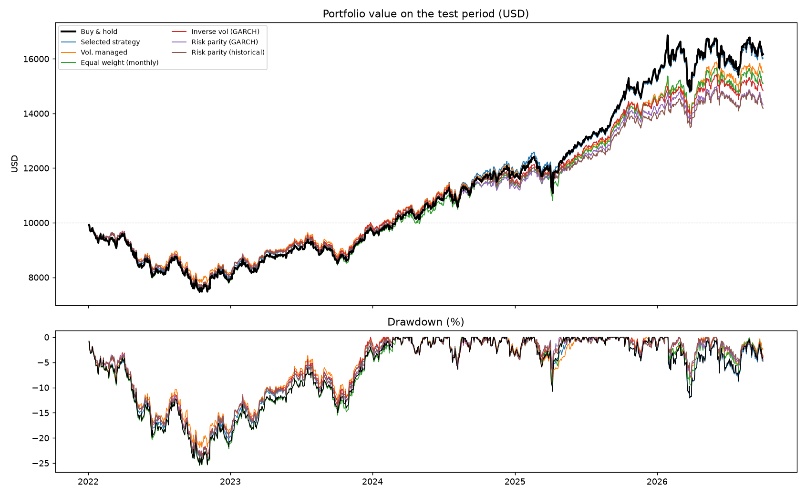
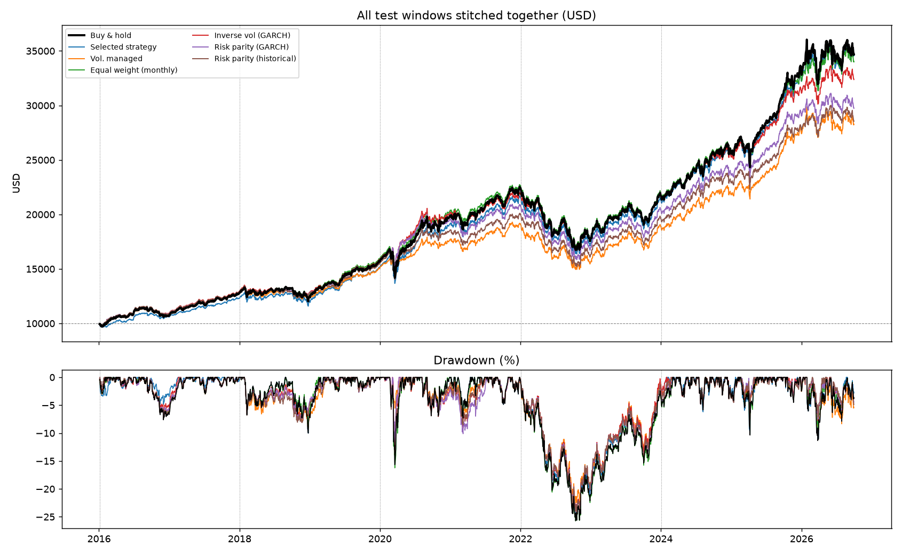

_Generated by `python -m beatbh` on 2026-11-11. Out-of-sample test period: 2022-01-03 to 2026-09-30. USD 10,000 initial capital, costs included, cash earns T-bills, Sharpe ratios in excess of T-bills._

**Key results**

- Return forecasts significantly more accurate than a random walk on the test period (Diebold-Mariano, 5 %): none, out of 16 model-asset pairs.
- Direction classifiers (logistic regression, gradient boosting) called the sign of the next day's return correctly 49.3-54.3 % of the time; always answering 'up' scored 52.8 %.
- Strategy selected on validation (SPY: Vol (1.50), QQQ: Vol (1.25), GLD: B&H, TLT: B&H) vs buy & hold on the test period: Sharpe 0.53 vs 0.52 (Holm-adjusted p = 1.00).
- Strategies whose Sharpe ratio differs significantly from buy & hold on the test period (HAC test, Holm-adjusted, 5 %): none.
- Repeating everything on 5 consecutive test windows (2016-2026), the selected strategy beat buy & hold's Sharpe in 2 of 5; on the stitched 2,701-day out-of-sample record the difference is +0.02 (Holm-adjusted p = 1.00).
- Significant differences on the stitched record (Holm, 5 %): none.

**Test period, 2022-01-03 to 2026-09-30**

| Strategy | CAGR % | Volatility % | Sharpe | Max drawdown % | ΔSharpe vs B&H | p (HAC, Holm) | p (bootstrap) |
|---|---|---|---|---|---|---|---|
| Buy & hold | 10.70 | 13.79 | 0.52 | -25.34 | – | – | – |
| Selected strategy | 10.50 | 13.08 | 0.53 | -24.19 | 0.01 | 1.00 | 0.84 |
| Vol. managed | 9.74 | 11.28 | 0.53 | -21.91 | 0.01 | 1.00 | 0.92 |
| Equal weight (monthly) | 9.11 | 13.04 | 0.43 | -25.49 | -0.09 | 1.00 | 0.18 |
| Inverse vol (GARCH) | 8.71 | 11.67 | 0.44 | -23.97 | -0.08 | 1.00 | 0.42 |
| Risk parity (GARCH) | 7.89 | 11.39 | 0.38 | -24.09 | -0.14 | 1.00 | 0.23 |
| Risk parity (historical) | 7.68 | 11.43 | 0.36 | -24.17 | -0.16 | 1.00 | 0.19 |

**Robustness: the whole procedure repeated on consecutive test windows**

Sharpe ratio per test window (each window has its own train and validation periods):

| Strategy | 2016-2017 | 2018-2019 | 2020-2021 | 2022-2023 | 2024-2026 | mean | beats_bh |
|---|---|---|---|---|---|---|---|
| Buy & hold | 1.84 | 0.99 | 1.39 | -0.29 | 1.02 | 0.99 | - |
| Selected strategy | 1.76 | 0.99 | 1.39 | -0.25 | 1.11 | 1.00 | 2 of 5 |
| Vol. managed | 1.88 | 0.90 | 1.47 | -0.27 | 1.01 | 1.00 | 3 of 5 |
| Equal weight (monthly) | 1.89 | 1.08 | 1.35 | -0.29 | 1.01 | 1.01 | 3 of 5 |
| Inverse vol (GARCH) | 1.98 | 1.14 | 1.42 | -0.24 | 1.01 | 1.06 | 4 of 5 |
| Risk parity (GARCH) | 1.94 | 1.18 | 1.30 | -0.29 | 0.96 | 1.02 | 2 of 5 |
| Risk parity (historical) | 1.99 | 1.04 | 1.17 | -0.29 | 0.93 | 0.97 | 2 of 5 |

All windows stitched together:

| Strategy | CAGR % | Volatility % | Sharpe | Max drawdown % | ΔSharpe vs B&H | p (HAC, Holm) | p (bootstrap) |
|---|---|---|---|---|---|---|---|
| Buy & hold | 12.30 | 11.63 | 0.86 | -25.70 | – | – | – |
| Selected strategy | 12.27 | 11.23 | 0.89 | -24.56 | 0.02 | 1.00 | 0.64 |
| Vol. managed | 10.17 | 9.29 | 0.85 | -22.52 | -0.02 | 1.00 | 0.88 |
| Equal weight (monthly) | 12.09 | 11.44 | 0.86 | -25.75 | -0.00 | 1.00 | 0.89 |
| Inverse vol (GARCH) | 11.58 | 10.14 | 0.91 | -24.18 | 0.05 | 1.00 | 0.54 |
| Risk parity (GARCH) | 10.70 | 9.84 | 0.85 | -24.32 | -0.01 | 1.00 | 0.93 |
| Risk parity (historical) | 10.28 | 9.95 | 0.81 | -24.34 | -0.06 | 1.00 | 0.50 |

